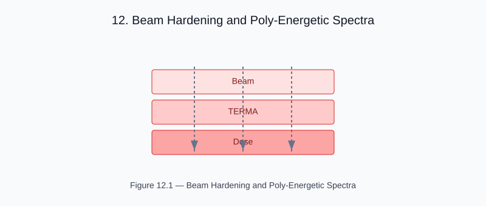

# Chapter 12 — Beam Hardening and Poly-Energetic Spectra

<!-- generated-figure-start -->

*Figure 12.1 — Beam Hardening and Poly-Energetic Spectra*
<!-- generated-figure-end -->

Real photon beams are poly-energetic: a 6 MV treatment beam contains photons
from ~0.1 MeV to 6 MeV. As the beam penetrates tissue, low-energy photons are
preferentially absorbed (beam hardening), shifting the mean energy upward.

## Spectral Components

Helios models a beam as a sum of SpectralComponent range bins, each
carrying upstream/downstream transport ranges and an energy-fluence
weight (harder components reach farther downstream):

```text
use aequitas::systems::si::{
    quantities::{Dimensionless, Length},
    units::Centimeter,
};
use helios_simulation::SpectralComponent;

let spectrum = vec![
    SpectralComponent {
        range_up: Length::from_unit::<Centimeter>(0.10),
        range_down: Length::from_unit::<Centimeter>(0.35),
        weight: Dimensionless::from_base(0.35),
    }, // soft component
    SpectralComponent {
        range_up: Length::from_unit::<Centimeter>(0.07),
        range_down: Length::from_unit::<Centimeter>(0.60),
        weight: Dimensionless::from_base(0.45),
    }, // mid component
    SpectralComponent {
        range_up: Length::from_unit::<Centimeter>(0.05),
        range_down: Length::from_unit::<Centimeter>(0.90),
        weight: Dimensionless::from_base(0.20),
    }, // hard component (reaches farther downstream)
];
```

## Beam-Hardened Transport

For each spectral component, the collapsed-cone kernel contributes its
monoenergetic deposition shape over the component's own transport
ranges, producing energy-dependent depth–dose curves. The total dose is
the energy-fluence-weighted sum:

```text
D(r) = Σ_k  w_k · D_k(r; μ_k)
```

## Clinical Significance

Ignoring beam hardening introduces depth-dose errors of 3–5% at 20 cm depth.
The poly-energetic model reduces this to < 1%.

## Further Reading

- [Collapsed-Cone Convolution](dose_collapsed_cone.md)
- [Example: Tomotherapy Workflow](examples/tomotherapy_workflow.md)
