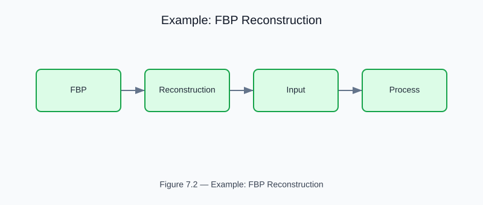

# Example: FBP Reconstruction

<!-- generated-figure-start -->

*Figure 7.2 — Example: FBP Reconstruction*
<!-- generated-figure-end -->

**Crate**: `helios-imaging`  
**Run**: `cargo run -p helios-imaging --example fbp_reconstruction`  
**Source**: [`crates/helios-imaging/examples/fbp_reconstruction.rs`](../../../crates/helios-imaging/examples/fbp_reconstruction.rs)

## What This Example Demonstrates

Full round-trip: disk phantom → parallel-beam Radon sinogram → Ram-Lak filtered
back-projection → reconstructed μ volume. Validates that the centre voxel
recovers the true attenuation `μ₀` to within 15% FBP discretization tolerance.

| Step | API |
|---|---|
| Forward project | `parallel_beam_radon(phantom, angles, offsets, src_dist, step)` |
| Reconstruct | `filtered_back_projection(sinogram, recon_grid)` |
| Sample result | `recon.get(i, j, k)` |

## Key Code Snippet

```text
use aequitas::systems::si::{
    quantities::{Angle, Length},
    units::{Millimeter, Radian},
};
use helios_domain::VoxelGrid;
use helios_imaging::{fbp::filtered_back_projection, radon::parallel_beam_radon};
use helios_math::Point3;

// 180 angles, 181 detector offsets
let angles: Vec<Angle<f64>> = (0..180)
    .map(|a| Angle::from_unit::<Radian>(a as f64 * std::f64::consts::PI / 180.0))
    .collect();
let offsets: Vec<Length<f64>> = (0..181)
    .map(|j| Length::from_unit::<Millimeter>(-45.0 + j as f64 * 0.5))
    .collect();
let sino = parallel_beam_radon(
    &phantom,
    &angles,
    &offsets,
    Length::from_unit::<Millimeter>(400.0),
    Length::from_unit::<Millimeter>(0.25),
);

// 41×41×1 reconstruction at 2 mm
let recon_grid = VoxelGrid::axis_aligned(
    [41, 41, 1],
    [Length::from_unit::<Millimeter>(2.0); 3],
    Point3::new(0.0, 0.0, 0.0),
)?;
let recon = filtered_back_projection(&sino, &recon_grid);

// Centre pixel should recover μ₀ = 0.04 cm⁻¹
let mu_centre = recon.get(20, 20, 0).expect("centre voxel in range");
```

## Physics Background

Filtered back-projection inverts the Radon transform:

1. **Ramp filtering** — each projection `p(θ, s)` is convolved with the
   Ram-Lak kernel `h[n] = 1/(4Δs²)` at `n=0`, `−1/(π²n²Δs²)` for odd `n`.
2. **Back-projection** — the filtered projections are smeared back across the
   reconstruction grid, weighted by the angular step `Δθ`.

FBP is the analytical inverse for ideal continuous data; the 15% tolerance
accounts for voxelization, limited angular sampling, and ray-march discretization.

## Book Chapter

[← Filtered Back Projection](../imaging_fbp.md)
