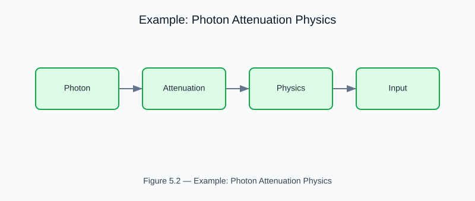
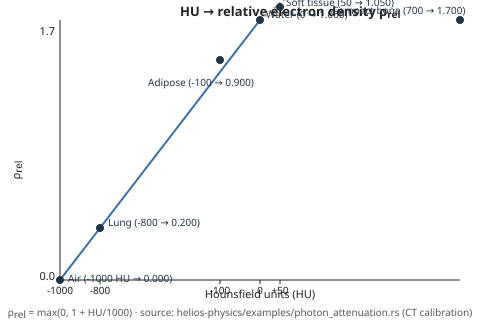

# Example: Photon Attenuation Physics

<!-- generated-figure-start -->

*Figure 5.2 — Example: Photon Attenuation Physics*
<!-- generated-figure-end -->

**Crate**: `helios-physics`  
**Run**: `cargo run -p helios-physics --example photon_attenuation`  
**Source**: [`crates/helios-physics/examples/photon_attenuation.rs`](../../../crates/helios-physics/examples/photon_attenuation.rs)

## What This Example Demonstrates

Exercises the core photon-interaction physics in `helios-physics`:

| Concept | API |
|---|---|
| Linear attenuation coefficient | `LinearAttenuation::new(mu)` |
| Beer–Lambert transmission | `mu.transmission(path_cm)` |
| Half-value layer | `mu.half_value_layer()` |
| Mass attenuation → linear | `mu_rho.to_linear(density)` |
| CT number → electron density | `relative_electron_density_from_hu(hu)` |
| CT number → mass density | `mass_density_from_hu(hu, water_rho)` |

## Key Code Snippet

```text
use aequitas::systems::si::{
    quantities::{Length, ReciprocalLength},
    units::{Centimeter, PerCentimeter},
};
use helios_physics::{mass_density_from_hu, relative_electron_density_from_hu};
use hyperion::{
    coefficient::{InteractionCoefficient, LinearAttenuation},
    quantity::PathLength,
};

// Water at 100 keV: μ ≈ 0.171 cm⁻¹
let mu = InteractionCoefficient::<_, LinearAttenuation>::new(
    ReciprocalLength::from_unit::<PerCentimeter>(0.171_f64),
)
.expect("valid μ");
let hvl = mu
    .half_value_layer()
    .expect("finite coefficient")
    .expect("non-zero μ"); // ≈ 4.05 cm

// 10 cm path → transmitted fraction
let depth = PathLength::new(Length::from_unit::<Centimeter>(10.0)).expect("finite depth");
let t = mu
    .optical_depth(depth)
    .expect("finite optical depth")
    .transmission(); // exp(-μ·x)

// CT-number calibration
let rho_rel = relative_electron_density_from_hu(0.0_f64); // water → 1.0
```

## Physics Background

The **Beer–Lambert law** describes narrow-beam attenuation:

```text
I(x) / I₀ = exp(−μ · x)
```

where `μ` (cm⁻¹) is the linear attenuation coefficient. For a compound
material, `μ = (μ/ρ) · ρ` where `μ/ρ` (cm²/g) is the material-specific
mass attenuation coefficient (tabulated in NIST XCOM).

The **CT calibration** maps Hounsfield units to relative electron density via
`ρ_rel = max(0, 1 + HU/1000)` — the first-order linear model used as the
vendor-independent baseline before scanner-specific stoichiometric calibration.

## Generated Figure

This example underwrites the deterministic figure committed to the book:



The figure values match the printed `transmission_at(depth)` and
`relative_electron_density_from_hu(hu)` outputs to four decimal places.

## Book Chapter

[← Hounsfield Units and Attenuation Maps](../imaging_ct.md)
