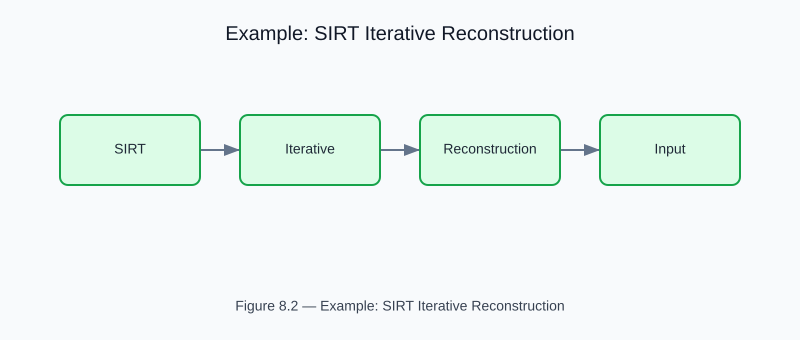

# Example: SIRT Iterative CT Reconstruction

<!-- generated-figure-start -->

*Figure 8.2 — Example: SIRT Iterative Reconstruction*
<!-- generated-figure-end -->

**Crate**: `helios-imaging`  
**Run**: `cargo run -p helios-imaging --example sirt_reconstruction`  
**Source**: [`crates/helios-imaging/examples/sirt_reconstruction.rs`](../../../crates/helios-imaging/examples/sirt_reconstruction.rs)

## What This Example Demonstrates

Algebraic iterative reconstruction of a 64×64 water/bone phantom from a 32-angle
sinogram, comparing SIRT convergence against the FBP analytic baseline.

| Stage | API | Physics |
|---|---|---|
| Phantom | `Volume::from_shape_fn` | Water μ = 0.02 cm⁻¹, Bone μ = 0.04 cm⁻¹ |
| Sinogram | `parallel_beam_radon(&phantom, &angles, &offsets, source, step)` | 32-angle parallel beam |
| FBP (baseline) | `filtered_back_projection(&sinogram, &grid)` | Ramp-filtered back-projection |
| SIRT | `sirt_reconstruction(&sinogram, &grid, source, step, iters, λ)` | 10 iterations, λ = 1.0 |

## Key Code Snippet

```text
use aequitas::systems::si::{quantities::Length, units::Millimeter};
use helios_imaging::{
    radon::parallel_beam_radon, fbp::filtered_back_projection, sirt_reconstruction,
};

let source = Length::from_unit::<Millimeter>(500.0);
let step = Length::from_unit::<Millimeter>(1.0);
let sinogram = parallel_beam_radon(&phantom, &angles, &offsets, source, step);

// Analytic (one-pass) baseline
let fbp = filtered_back_projection(&sinogram, &grid);

// Iterative — robust to undersampling
let sirt = sirt_reconstruction(&sinogram, &grid, source, step, 10, 1.0);
```

## Physics Background

SIRT solves the linear system `Ax = b` (sinogram = projection matrix × attenuation)
iteratively via normalized back-projection updates:

```text
x ← max(0, x + λ · C⁻¹ ⊙ Aᵀ( R⁻¹ ⊙ (b − Ax) ))
```

where `R⁻¹` normalizes by ray chord length and `C⁻¹` by voxel hit weight.
The non-negativity projection encodes `μ ≥ 0`. FBP is O(N² log N) but
creates streak artefacts under sparse sampling; SIRT is O(N² × iterations)
and converges to the least-squares solution.

## Book Chapter

[← MVCT and Correction Workflows](../imaging_mvct.md)
