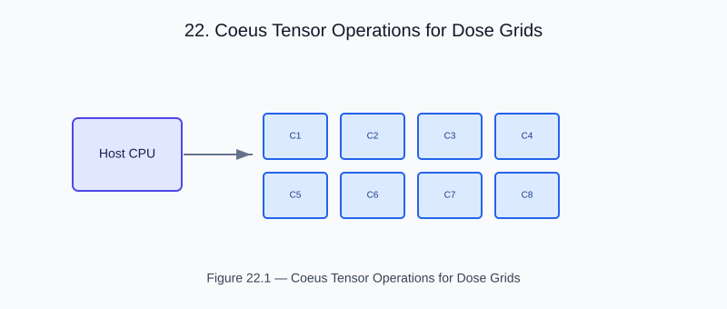

# Chapter 22 — Coeus Tensor Operations for Dose Grids

<!-- generated-figure-start -->

*Figure 22.1 — Coeus Tensor Operations for Dose Grids*
<!-- generated-figure-end -->

Differentiable planning objectives run on coeus tapes behind the
`autodiff` feature: `Var<T, Backend>` values built with
`Tensor::from_slice_on`, composed with `coeus_autograd` operators.
GPU-resident attenuation, projection, and transmission kernels live in
helios-gpu on the Themis placement contract instead.

## Tensor-Based Dose Operations

```text
use coeus_autograd::{matmul, Var};
use coeus_core::MoiraiBackend;
use coeus_tensor::Tensor;

let backend = MoiraiBackend::new();
let a = Var::new(
    Tensor::from_slice_on(vec![voxels, beamlets], influence.rows(), &backend)?,
    false,
)?;
let x = Var::new(
    Tensor::from_slice_on(vec![beamlets, 1], &weights, &backend)?,
    true,
)?;
let dose = matmul(&a, &x)?;
```

## autodiff Integration

coeus-autograd enables gradient computation through dose calculation,
supporting inverse planning and machine-learning surrogate training.

## Further Reading

- [GPU Backend Overview](gpu_overview.md)
- [Coeus crate](https://github.com/ryancinsight/Coeus)
