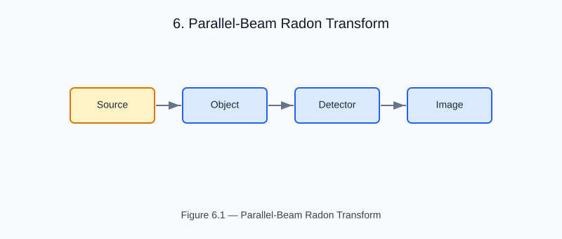

# Chapter 6 — Parallel-Beam Radon Transform

<!-- generated-figure-start -->

*Figure 6.1 — Parallel-Beam Radon Transform*
<!-- generated-figure-end -->

The Radon transform forward-projects a 2-D attenuation map μ(x, y) along
parallel rays at 
_angles uniformly-spaced rotation angles:

```text
R[θ, t] = ∫ μ(t·cos θ − s·sin θ, t·sin θ + s·cos θ) ds
```

In Helios the Radon transform is provided by helios-imaging:

```text
use aequitas::systems::si::{
    quantities::{Angle, Length},
    units::{Millimeter, Radian},
};
use helios_imaging::radon::parallel_beam_radon;

let angles: Vec<Angle<f64>> = (0..180)
    .map(|a| Angle::from_unit::<Radian>(a as f64 * std::f64::consts::PI / 180.0))
    .collect();
let offsets: Vec<Length<f64>> = (0..181)
    .map(|j| Length::from_unit::<Millimeter>(-45.0 + j as f64 * 0.5))
    .collect();
let sinogram = parallel_beam_radon(
    &mu_volume,
    &angles,
    &offsets,
    Length::from_unit::<Millimeter>(400.0),
    Length::from_unit::<Millimeter>(0.25),
);
// sinogram covers 180 angles × 181 detector offsets
```

## Physical Interpretation

Each row of the sinogram is the projection at one gantry angle.
For a cylinder of uniform attenuation μ₀:

```text
R[θ, 0] = μ₀ · 2√(r² − t²)  for |t| < r
```

This analytical oracle is used in the regression tests.

## Performance

The implementation is parallelised via moirai::map_collect_index_with —
each angle is computed independently on a separate thread.

## Further Reading

- [Example: Tomotherapy Workflow](examples/tomotherapy_workflow.md)
- [Filtered Back Projection](imaging_fbp.md)
- [Dose Calculation: Terma](dose_terma.md)
