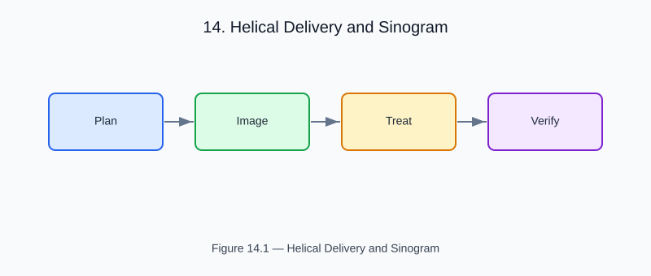

# Chapter 14 — Helical Delivery and Sinogram

<!-- generated-figure-start -->

*Figure 14.1 — Helical Delivery and Sinogram*
<!-- generated-figure-end -->

TomoTherapy delivers dose helically: the gantry rotates while the couch
translates, producing a helical trajectory of the beam relative to the patient.

```text
use aequitas::systems::si::{
    quantities::{Angle, Dimensionless, Length, Time},
    units::{Millimeter, Radian, Second},
};
use helios_domain::HelicalDelivery;

let delivery = HelicalDelivery::new(
    51,                                     // projections per rotation
    Length::from_unit::<Millimeter>(25.0),  // 2.5 cm field width
    Dimensionless::from_base(0.287),        // couch advance per rotation / field width
    Time::from_unit::<Second>(20.0),        // seconds per rotation
    Angle::from_unit::<Radian>(0.0),
    Length::from_unit::<Millimeter>(0.0),
)?;
```

## Pitch

Pitch = (couch advance per rotation) / (field width). Typical values: 0.2–0.4.
Lower pitch = more overlap = higher dose uniformity but longer treatment.

## Sinogram

The delivery sinogram has shape `(n_gantry_angles, n_leaves)`.
For a standard TomoTherapy treatment: 51 gantry projections × 64 leaves.

## Further Reading

- [MLC Models and Leaf Sequencing](planning_mlc.md)
- [Example: Tomotherapy Workflow](examples/tomotherapy_workflow.md)
