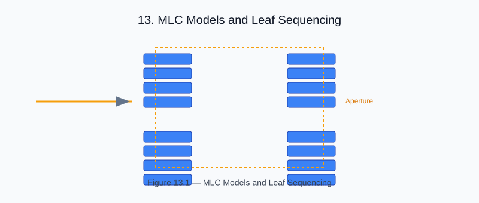

# Chapter 13 — MLC Models and Leaf Sequencing

<!-- generated-figure-start -->

*Figure 13.1 — MLC Models and Leaf Sequencing*
<!-- generated-figure-end -->

The Multi-Leaf Collimator (MLC) is the binary modulator in a TomoTherapy
machine. Each leaf is either open or closed per projection; the
`LeafOpenTimeSinogram` encodes the open fraction per leaf per projection,
and `MlcModel` carries the leakage and tongue-and-groove corrections.

```text
use helios_domain::{LeafOpenTimeSinogram, MlcModel};

let mlc = MlcModel::new(0.01, 0.05)?; // 1% leakage, 5% tongue-and-groove
let lots = LeafOpenTimeSinogram::from_fractions(projections, leaves, fractions)?;
```

## Leaf Open Time

LeafOpenTimeSinogram (LOTS) encodes the fraction of each gantry rotation
that each leaf is open: values in `0..=1`. At 0 the leaf is always closed,
at 1 always open.

## Tongue-and-Groove Effect

Adjacent leaf pairs share a slight overlap (tongue-and-groove feature) that
reduces interleaf leakage. MlcModel accounts for this in fluence calculation.

## Further Reading

- [Helical Delivery and Sinogram](planning_helical.md)
- [Example: Tomotherapy Workflow](examples/tomotherapy_workflow.md)
