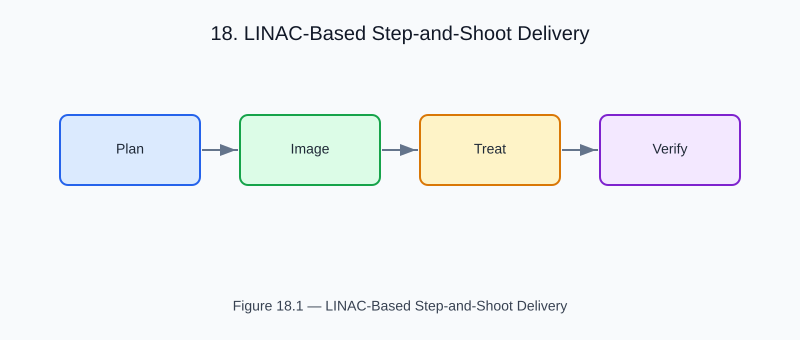

# Chapter 18 — LINAC-Based Step-and-Shoot Delivery

<!-- generated-figure-start -->

*Figure 18.1 — LINAC-Based Step-and-Shoot Delivery*
<!-- generated-figure-end -->

Linear accelerator (LINAC) IMRT delivers dose through a sequence of static
beam apertures (step-and-shoot) or dynamically moving MLC leaves (sliding window).

## Step-and-Shoot IMRT

Each step-and-shoot field is a `DeliveryFrame` with:
- A gantry angle (`gantry_angle_rad`)
- A couch position (`couch`)
- Per-leaf fluence (`leaf_fluence`, 16 leaves × 2 mm in the worked example)

```text
use aequitas::systems::si::{
    quantities::{Angle, EnergyPerArea, Length},
    units::{Millimeter, Radian},
};
use helios_simulation::DeliveryFrame;

let frame = DeliveryFrame {
    projection: 0,
    gantry_angle_rad: Angle::from_unit::<Radian>(0.0),
    couch: Length::from_unit::<Millimeter>(0.0),
    leaf_fluence: vec![EnergyPerArea::from_base(1.0); 16],
};
```

## Dose Calculation

Same collapsed-cone engine as TomoTherapy, applied field-by-field
and summed:

```text
use aequitas::systems::si::{quantities::Length, units::Millimeter};
use helios_simulation::{accumulate_delivered_dose, BeamGeometry};

let total_dose = accumulate_delivered_dose(
    &frames,
    &mu,
    BeamGeometry::Parallel {
        standoff: Length::from_unit::<Millimeter>(500.0),
    },
    Length::from_unit::<Millimeter>(2.0),
    Length::from_unit::<Millimeter>(0.5),
)?;
```

## Further Reading

- [TomoTherapy End-to-End Workflow](workflow_tomotherapy.md)
- [Adaptive Radiotherapy with MVCT](workflow_adaptive.md)
