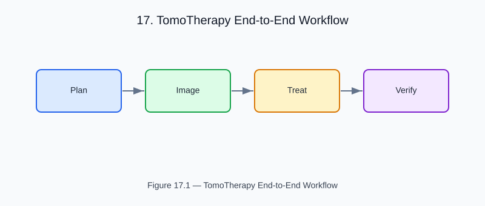

# Chapter 17 — TomoTherapy End-to-End Workflow

<!-- generated-figure-start -->

*Figure 17.1 — TomoTherapy End-to-End Workflow*
<!-- generated-figure-end -->

This chapter presents the complete helical TomoTherapy delivery and verification
pipeline — from CT imaging through dose calculation to plan QA.

## System Overview

```text
CT acquisition → Attenuation map → MVCT reconstruction
                                           │
                      Helical MLC delivery ┤
                                           │
                                 Dose calculation (Collapsed-cone)
                                           │
                            DVH + Gamma-index verification
```

## CT and MVCT Imaging

The imaging path converts CT Hounsfield Units (HU) to linear attenuation
coefficients (μ) using Hyperion mass-attenuation coefficients mapped by
`helios-solver`:

```text
use aequitas::systems::si::{
    quantities::{AreaPerMass, Length, MassDensity as DensityQuantity},
    units::{GramPerCubicCentimeter, Millimeter, SquareCentimeterPerGram},
};
use helios_solver::attenuation_map;
use helios_imaging::{fbp::filtered_back_projection, radon::parallel_beam_radon};
use hyperion::coefficient::MassAttenuation;

let mu_over_rho = MassAttenuation::new(AreaPerMass::from_unit::<SquareCentimeterPerGram>(0.0636))?;
let water = DensityQuantity::from_unit::<GramPerCubicCentimeter>(1.0);
let mu = attenuation_map(&ct_volume, mu_over_rho, water)?;
let sinogram = parallel_beam_radon(
    &mu,
    &angles,
    &offsets,
    Length::from_unit::<Millimeter>(400.0),
    Length::from_unit::<Millimeter>(0.25),
);
let recon = filtered_back_projection(&sinogram, &recon_grid);
```

## Helical Delivery Simulation

A helical MLC delivery is defined by a `LeafOpenTimeSinogram` (LOTS) encoding the
per-gantry-angle leaf opening times. `simulate_helical_delivery` turns the
delivery, leaf-open fractions, and MLC model into per-projection delivery
frames (terma is accumulated from these frames downstream):

```text
use aequitas::systems::si::{
    quantities::{Angle, Dimensionless, Length, Time},
    units::{Millimeter, Radian, Second},
};
use helios_domain::{HelicalDelivery, LeafOpenTimeSinogram, MlcModel};
use helios_simulation::simulate_helical_delivery;

let delivery = HelicalDelivery::new(
    51,
    Length::from_unit::<Millimeter>(20.0),
    Dimensionless::from_base(0.3),
    Time::from_unit::<Second>(10.0),
    Angle::from_unit::<Radian>(0.0),
    Length::from_unit::<Millimeter>(0.0),
)?;
let lot = LeafOpenTimeSinogram::from_fractions(projections, leaves, fractions)?;
let mlc = MlcModel::new(0.01, 0.05)?;
let frames = simulate_helical_delivery(&delivery, &lot, &mlc);
```

## Collapsed-Cone Dose

The `CollapsedCone` solver converts terma to dose using a poly-energetic
beam-hardening correction driven by the spectral components:

```text
use aequitas::systems::si::{quantities::Length, units::Millimeter};
use helios_simulation::accumulate_delivered_dose_anisotropic;

let dose = accumulate_delivered_dose_anisotropic(
    &frames,
    &mu,
    geometry,
    Length::from_unit::<Millimeter>(3.0),
    Length::from_unit::<Millimeter>(0.25),
    &cone,
)?;
```

## Plan Quality Assurance

The `helios-analysis` crate provides:
- `Dvh` — Dose-Volume Histogram with D95/V20 lookup
- `gamma_index_3d` — per-voxel gamma metric (ΔD/δD)² + (Δr/δr)²
- `gamma_pass_rate` — fraction of voxels with γ < 1

```text
use aequitas::systems::si::{
    quantities::{AbsorbedDose, Length},
    units::{Gray, Millimeter},
};

let dvh = Dvh::from_volume(&dose);
let gamma = gamma_index_3d(
    &dose,
    &reference_dose,
    0.03,
    Length::from_unit::<Millimeter>(2.0),
    AbsorbedDose::from_unit::<Gray>(5.0),
    Length::from_unit::<Millimeter>(6.0),
)?;
println!(
    "Pass rate: {:.1}%",
    gamma_pass_rate(&gamma, &reference_dose, AbsorbedDose::from_base(0.0)) * 100.0
);
```

## Further Reading

- [Example: Tomotherapy Workflow](examples/tomotherapy_workflow.md)
- [`helios-simulation` source](../../crates/helios-simulation/src/)
- [`helios-analysis` source](../../crates/helios-analysis/src/)
